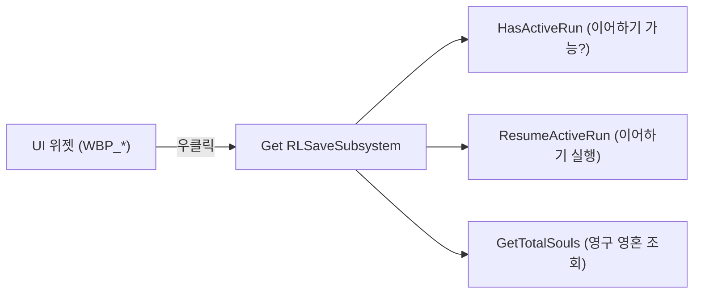

# 💾 세이브 & 메타 진행 시스템 UI 연동 가이드 (for UI 담당자)

> **문서 대상:** UI / UMG 제작 담당 팀원 (`WBP_TitleMenu`, `WBP_HUD`, `WBP_PauseMenu`, `WBP_GameOver`, `WBP_MetaUpgrade` 제작자)  
> **최종 갱신:** 2026-10-05  
> **핵심 C++ 클래스:** `URLSaveSubsystem` (GameInstanceSubsystem), `URLSaveGame`

---

## 📌 1. 핵심 요약 (TL;DR)

- **서브시스템 위치:** `GameInstance` 서브시스템으로 등록되어 있어, 레벨이 바뀌거나 위젯 안에서도 언제든 `Get RLSaveSubsystem` 노드로 즉시 접근할 수 있습니다.
- **2-Track 저장 구조:**
  1. **[Track 1] 영구 메타 세이브 (`RL_MetaSave.sav`)**: 사망해도 절대 사라지지 않는 계정 누적 영혼(`Souls`), 최고 클리어 스테이지, 영구 해금/특성 레벨.
  2. **[Track 2] 런 세이브 (`RL_RunSave.sav`)**: 1회차 런 진행 데이터(현재 스테이지, 플레이어 위치, HP, 스탯, 인벤토리, 스킬). **포탈 탑승 시 자동 저장**되며, **사망 시 영구 삭제(초기화)**됩니다.
- **자동 이어하기 지원:** 저장된 런이 있는 상태에서 게임을 켜면, 별도 조작 없이도 **저장했던 좌표와 스탯/아이템 상태로 자동 복원**됩니다.

---

## 🧭 2. 서브시스템 노드 가져오는 법 (블루프린트)

모든 위젯 블루프린트에서 우클릭 후:
- **`Get RLSaveSubsystem`** (또는 `Get Game Instance Subsystem` → Class를 `RLSaveSubsystem`으로 선택)

---

## 🖥️ 3. UI 화면별 연동 가이드

### ① 타이틀 / 메인 메뉴 (`WBP_TitleMenu`)

#### [이어하기 (Continue)] 버튼
- **버튼 활성화/비활성화 판정 (`Event Construct` 또는 `OnOpened`):**
  - `Get RLSaveSubsystem` → **`HasActiveRun`** 호출
  - 반환값이 `true`이면 버튼 활성화 (`SetIsEnabled(true)`), `false`이면 비활성화 (`SetIsEnabled(false)` 또는 숨김).
- **이어하기 정보 표시 (선택 사항):**
  - `Get Active Run Data` 노드를 풀어서 다음 정보를 텍스트로 표시할 수 있습니다:
    - `StageNumber`: 진행 중인 스테이지 (예: *"Stage 2"*)
    - `SaveTimestamp`: 저장 일시 (예: *"2026-10-05 19:45"*)
- **버튼 클릭(`OnClicked`) 시:**
  - `Get RLSaveSubsystem` → **`ResumeActiveRun`** 호출!
  - *(저장된 맵을 자동으로 열고, 플레이어를 저장 위치로 텔레포트하며 체력/스탯/아이템/스킬을 완전 복원합니다.)*

#### [새 게임 (New Game)] 버튼
- **버튼 클릭(`OnClicked`) 시:**
  - `Get RLSaveSubsystem` → **`ClearActiveRun(true)`** 호출 (이전 런 세이브 삭제)
  - `OpenLevelBySoftObjectPtr` 또는 `OpenLevel`로 1스테이지 맵(`Map_Persistent`) 오픈.

---

### ② 인게임 HUD (`WBP_HUD`)

#### 영구 영혼(Souls) 재화 실시간 표시
- **초기값 설정 (`Event Construct`):**
  - `Get RLSaveSubsystem` → **`GetTotalSouls`** 호출 후 텍스트 블록에 표시.
- **실시간 변화 감지 (델리게이트 이벤트 바인딩):**
  - `Get RLSaveSubsystem` → **`Assign OnSoulsChanged`** (이벤트 바인딩)
  - 이벤트 파라미터:
    - `NewTotal` (int32): 변경된 최종 보유 영혼
    - `DeltaAmount` (int32): 이번에 획득(+)하거나 소비(-)한 수량 (획득 연출이나 +10 팝업 텍스트용)

#### 현재 스테이지 표시
- `Get RLSaveSubsystem` → `Get Active Run Data` → `StageNumber` 조회.

---

### ③ 일시정지(Pause / ESC) 메뉴 (`WBP_PauseMenu`)

#### [저장하고 타이틀로 나가기] 버튼
- 플레이 중지 후 메인 메뉴로 나가고 싶을 때:
  1. `Get Player Character` (ARLCharacter) 가져오기
  2. 현재 맵 이름 가져오기 (`Get Current Level Name`)
  3. `Get RLSaveSubsystem` → **`SaveActiveRun(PlayerCharacter, CurrentLevelName, StageNumber)`** 호출
  4. 타이틀 맵(`Map_Title`)으로 이동.

---

### ④ 게임오버 / 사망 팝업 (`WBP_GameOver`)

- 플레이어 사망 시 C++ 내부에서 `HandlePlayerDeath`가 자동 호출되어 이번 런 세이브가 삭제되고, 이번 런에서 얻은 영혼은 메타로 입금됩니다.
- **결과창 텍스트:**
  - `Get Active Run Data`의 `RunSouls`를 읽어 *"이번 런에서 수집한 영혼: +X"* 출력 가능.
- **[타이틀 / 로비로 돌아가기] 버튼:**
  - 타이틀 맵 오픈. 다음 시작 시 자동으로 1스테이지 시작 지점에서 1레벨로 시작됩니다.

---

### ⑤ 영구 강화 / 메타 상점 UI (`WBP_MetaUpgrade`)

로비나 특성 창에서 영구적으로 능력치를 올리는 상점 UI:

| 함수 이름 | 파라미터 | 반환값 | 용도 및 설명 |
| :--- | :--- | :--- | :--- |
| **`GetTotalSouls`** | 없음 | `int32` | 현재 플레이어가 보유한 영구 영혼 잔액 반환 |
| **`SpendTotalSouls`** | `Amount` (int32) | `bool` | 영혼 소비. 잔액 부족 시 `false` 반환(구매 실패 처리), 충분 시 차감 후 자동 저장 및 `true` 반환 |
| **`AddTotalSouls`** | `Amount` (int32) | 없음 | 영구 영혼 지급 (보상이나 퀘스트 완료 시) |
| **`GetUpgradeLevel`** | `UpgradeKey` (FName) | `int32` | 해당 특성(예: `"MaxHealth_Up"`, `"Atk_Up"`)의 현재 강화 단계 반환 (기본 0) |
| **`SetUpgradeLevel`** | `UpgradeKey` (FName), `Level` (int32) | 없음 | 해당 특성 강화 단계 저장 (자동 디스크 저장됨) |
| **`IsIDUnlocked`** | `InID` (FName) | `bool` | 특정 캐릭터, 무기, 유물 ID가 해금되었는지 검사 |
| **`UnlockID`** | `InID` (FName) | 없음 | 특정 ID 영구 해금 처리 및 디스크 저장 |

---

## ⚡ 4. UI 갱신용 이벤트 델리게이트 목록

매 틱 검사(Tick)할 필요 없이 아래 이벤트들을 바인딩해 두면 UI가 자동으로 반응합니다:

| 델리게이트 이름 | 파라미터 | 발생 시점 & UI 활용 추천 |
| :--- | :--- | :--- |
| **`OnSoulsChanged`** | `NewTotal` (int32) `DeltaAmount` (int32) | 영구 영혼 획득 또는 소비 시 즉시 발생. HUD 상단 영혼 카운터 숫자 갱신 및 획득 애니메이션 연출 |
| **`OnRunSaveCompleted`**| `bSuccess` (bool) | 런 세이브 완료 시 (화면 구석에 *"자동 저장 완료..."* 아이콘 팝업 연출) |
| **`OnRunLoaded`** | `bSuccess` (bool) | 런 로드 완료 시 발생 |
| **`OnMetaSaved`** | `bSuccess` (bool) | 영구 메타 데이터 저장 완료 시 발생 |

---

## 🧪 5. 콘솔 치트 명령어 (테스트용)

개발 및 UI 테스트 중 키보드 `~` 키를 눌러 입력 가능한 콘솔 명령어:

- **`SaveCurrentRun`**: 현재 플레이어 위치, HP, 인벤토리, 스탯을 즉시 저장.
- **`LoadCurrentRun`**: 저장된 런을 불러와 현재 위치로 텔레포트 및 스탯 복원.
- **`ClearCurrentRun`**: 런 세이브를 즉시 삭제 (초기화 테스트용).
- **`AddSouls 500`**: 영구 영혼 재화 500개 즉시 지급 (상점 구매 UI 테스트용).
- **`TestGiveTestItems`**: 물약, 장신구, 장화, 루비, 300골드 즉시 지급.
