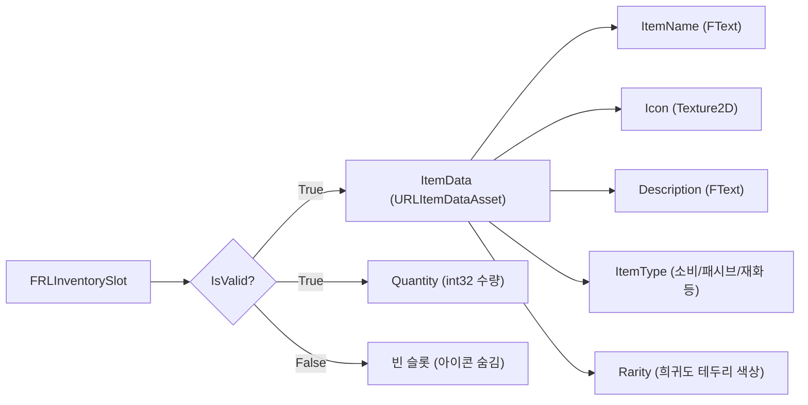

# 🎒 인벤토리 & 아이템 시스템 UI 연동 가이드 (for UI 담당자)

> **작성자:** HSJ (허성주)  
> **최종 갱신:** 2026-09-28  
> **대상:** UMG UI 담당 팀원 (`WBP_Inventory`, `WBP_InventorySlot`, `WBP_HUD` 제작자)

---

## 📌 1. 핵심 요약 (TL;DR)

- **컴포넌트 위치**: 플레이어 캐릭터(`ARLCharacter`)에 [`URLInventoryComponent`](file:///C:/Unreal%20Projects/TopViewRogueLike/Source/RogueLikeTopView/Inventory/Public/RLInventoryComponent.h)가 기본 부착되어 있습니다.
- **가져오는 법**: 플레이어 캐릭터에서 `Get Inventory Component` 노드를 호출하면 끝입니다.
- **UI 갱신 방식**: 매 틱 검사(Tick)할 필요 없이, **이벤트 델리게이트 4종**에 이벤트만 바인딩해 두면 아이템 획득/사용/골드 변화 시 UI가 자동으로 갱신됩니다.

---

## ⚡ 2. UI 연동 필수 델리게이트 (Events)

인벤토리 컴포넌트에서 아래 4개의 이벤트를 바인딩(`Assign` / `Bind Event`)하여 사용하세요.

| 델리게이트 이름 | 파라미터 | 용도 & 추천 UI 처리 |
| :--- | :--- | :--- |
| **`OnInventoryUpdated`** | 없음 | 인벤토리 전체 갱신 (인벤토리 창 열릴 때, 아이템 이동 시 전체 새로고침) |
| **`OnSlotUpdated`** | `SlotIndex` (int32) `SlotData` (FRLInventorySlot) | **성능 최적화용**: 변경된 해당 슬롯 1개만 갱신할 때 사용 |
| **`OnGoldChanged`** | `NewGold` (int32) | HUD 상단 골드 텍스트를 `NewGold` 값으로 갱신 |
| **`OnItemUsed`** | `ItemData` (URLItemDataAsset*) `SlotIndex` (int32) | 아이템 사용 시 효과음(SFX) 재생, 쿨타임 애니메이션, 반짝임 연출 |

---

## 🛠️ 3. UI에서 호출할 주요 함수 (Functions)

### ① 인벤토리 창 열릴 때 슬롯 생성/초기화
- **`GetSlots`**: 전체 슬롯 배열(`TArray<FRLInventorySlot>`) 반환 (기본 20칸).
  - 블루프린트에서 `For Each Loop`를 돌려 각 슬롯 위젯(`WBP_InventorySlot`)에 `SlotIndex`와 `SlotData`를 전달해 초기화합니다.
- **`GetMaxSlots`**: 최대 슬롯 개수 반환 (20).

### ② 아이템 사용 (우클릭 or 퀵슬롯 키 입력)
- **`UseItemAtIndex(SlotIndex)`**: 해당 번호 슬롯의 아이템을 사용합니다.
  - 소비 아이템(체력 물약 등)이면 즉시 회복 후 수량이 1개 차감되며 `OnSlotUpdated`가 자동 호출됩니다.
  - 체력이 꽉 차 있어 사용이 불가능할 경우 `false`를 반환합니다.

### ③ 슬롯 드래그 앤 드롭 (위치 이동/교환)
- **`SwapSlots(FromIndex, ToIndex)`**: 두 슬롯의 아이템 위치를 서로 맞바꿉니다.

### ④ 골드 조회
- **`GetGold`**: 현재 플레이어가 보유한 골드 정수값 반환.

---

## 📦 4. 슬롯 데이터 및 아이템 정보 읽는 법

각 슬롯은 **`FRLInventorySlot`** 구조체로 되어 있습니다.

### 블루프린트 Break 노드 팁:
1. `FRLInventorySlot`을 **Break** 합니다.
2. `Item Data`가 유효(Valid)한지 검사:
   - **유효하지 않음**: 빈 슬롯이므로 아이콘 숨김(`Set Visibility: Collapsed`), 수량 텍스트 숨김.
   - **유효함**: `Item Data`를 다시 **Break** 하거나 변수를 읽어옵니다:
     - **`Item Name`**: 아이템 이름 텍스트
     - **`Description`**: 툴팁용 설명 텍스트
     - **`Icon`**: 이미지 위젯에 `Set Brush from Texture` (또는 `Async Load Asset`)
     - **`Item Type`**: 소비(`Consumable`), 패시브 유물(`Passive`), 재료(`Material`) 태그 표시
     - **`Rarity`**: 희귀도 등급(일반/희귀/영웅/전설)에 따라 슬롯 테두리 색상 변경
     - **`Quantity`**: 수량 텍스트. 1개일 땐 숨기고, 2개 이상일 때만 `x2`, `x5`처럼 표시 추천.

---

## 🎨 5. 추천 위젯 구조

### `WBP_InventorySlot` (단일 슬롯 위젯)
- **계층 구조**:
  - `SizeBox` (예: 64x64 or 72x72)
    - `Border` (배경 및 희귀도 테두리)
      - `Button` (클릭/우클릭 이벤트 수신)
        - `Image` (아이템 아이콘)
        - `TextBlock` (우측 하단 수량 표시)
- **이벤트 구현**:
  - `OnMouseButtonDown`: 우클릭 감지 시 `UseItemAtIndex(MySlotIndex)` 호출
  - `OnMouseEnter`: 마우스 호버 시 툴팁(이름/설명) 표시
  - (선택) `OnDragDetected` / `OnDrop`: `SwapSlots` 노드로 드래그 앤 드롭 구현

### `WBP_Inventory` (전체 인벤토리 창)
- **계층 구조**:
  - `UniformGridPanel` 또는 `WrapBox` (4열 5행으로 20개 슬롯 자동 배치)
  - `TextBlock` (보유 골드 표시)
  - `Button` (닫기 버튼)
- **이벤트 바인딩 (`Event Construct`)**:
  1. `Get Player Character` → `Get Inventory Component`
  2. `Bind Event to OnInventoryUpdated` → 슬롯 전체 새로고침
  3. `Bind Event to OnSlotUpdated` → 해당 인덱스 슬롯 위젯만 새로고침

---

## 🧪 6. UI 제작 중 인게임 즉시 테스트 치트 (콘솔 명령어)

UI를 만들면서 아이템이 제대로 들어오고 갱신되는지 확인하려면, PIE(게임 플레이) 중 **`~` (콘솔 키)**를 눌러 아래 명령어를 사용하세요.

- **`TestGiveTestItems`**: 체력 물약(5개), 전사의 반지(공격력 유물), 신속의 장화(이속 유물), 루비(3개), 300 골드가 인벤토리에 즉시 들어옵니다.
- **`TestUseItemSlot 0`**: 0번 슬롯(물약)을 사용합니다. (체력 40 회복 및 개수 1개 차감)
- **`TestAddGold 100`**: 100 골드를 추가합니다.

궁금한 점이나 추가로 필요한 C++ 함수/델리게이트가 있다면 언제든 편하게 말씀해주세요!
